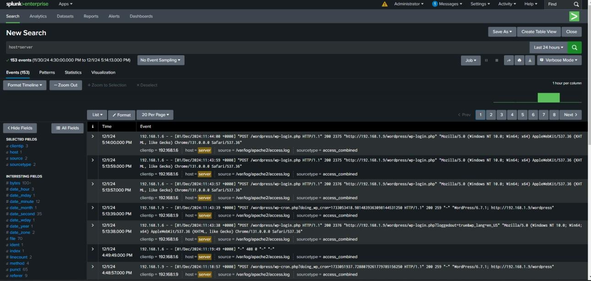
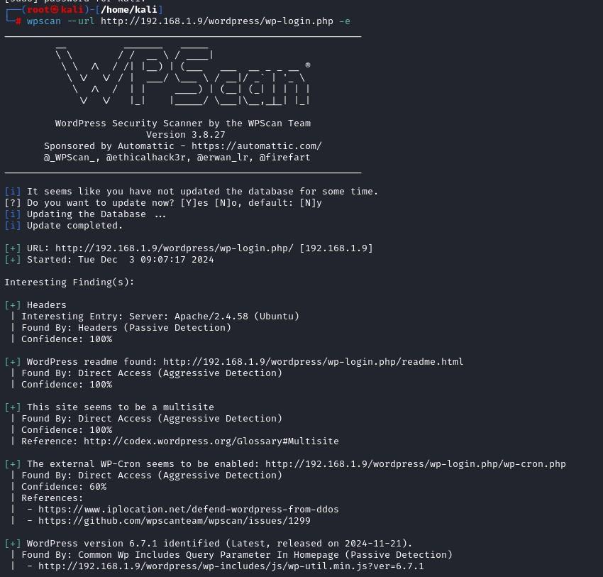
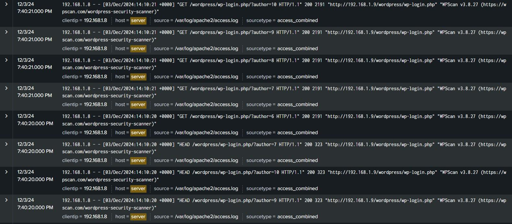
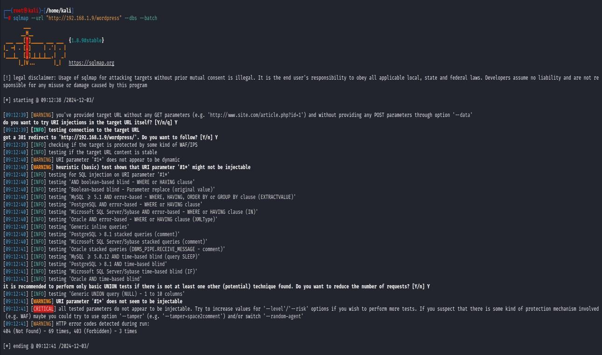
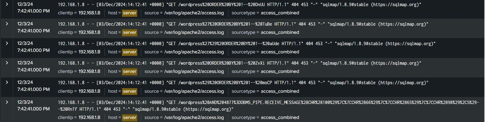

# WordPress Website Log Monitoring with Splunk

> Deploy a WordPress site on an Ubuntu 24.04 server (LAMP stack), ship its Apache logs to Splunk Enterprise, and detect brute-force logins, WPScan enumeration and SQLMap injection attempts from the logs.


**Author:** Muhammed Hisham K P · Soften Technologies Training Institute, Kochi
**Type:** Cyber security project · Blue team / log monitoring

---

## Overview

An internet-facing WordPress site is a constant target, and every request it serves is written to a log. This project builds a small but realistic monitoring pipeline:

1. A WordPress site on an Ubuntu server (Apache2 + MySQL + PHP).
2. Splunk Enterprise on a separate monitoring machine receiving the Apache logs.
3. Attacks launched from Kali Linux (failed logins, WPScan, SQLMap) to prove they show up in Splunk with source IP and user-agent.

## Lab architecture

```
 Kali Linux (attacker)        Ubuntu 24.04 Server              Monitoring machine
 192.168.1.8                  192.168.1.9                      192.168.1.6
 wpscan, sqlmap     ───────►  Apache2 + MySQL + WordPress      Splunk Enterprise
                              Splunk Universal Forwarder ───►  receiving on TCP 9997
                              /var/log/apache2/*.log
```

| Machine | Role | IP |
|---|---|---|
| Ubuntu Server 24.04 | WordPress host, Splunk UF | 192.168.1.9 |
| Windows host | Splunk Enterprise (indexer + search) | 192.168.1.6 |
| Kali Linux | Attacker | 192.168.1.8 |

## Stack

Ubuntu Server 24.04 LTS · Apache2 · MySQL 8.0 · PHP 8.3 · WordPress 6.7.1 · UFW · Splunk Enterprise 9.3 · Splunk Universal Forwarder 9.3.2 · WPScan · SQLMap

## What was done

| # | Phase | Details |
|---|---|---|
| 1 | Prepare server | Install Ubuntu, update system, enable UFW |
| 2 | Web server | Install and verify Apache2 |
| 3 | Database | Install MySQL, create `wordpress_db` and a least-privilege user |
| 4 | Application | Install PHP, download WordPress, set ownership and permissions |
| 5 | Configure | Apache virtual host, `wp-config.php`, restart Apache |
| 6 | Launch | WordPress setup wizard, admin dashboard |
| 7 | Splunk | Install Splunk Enterprise, enable receiving on port 9997 |
| 8 | Forwarder | Install Universal Forwarder, forward Apache access and error logs |
| 9 | Test | Failed logins, WPScan, SQLMap, then search them in Splunk |

Full commands are in [`docs/setup-guide.md`](docs/setup-guide.md).

## Results

### Failed WordPress logins
Wrong passwords on `wp-login.php` appear as `POST` requests with the client IP and timestamp.



### WPScan enumeration
WPScan fingerprinted Apache 2.4.58, WordPress 6.7.1, `readme.html` and WP-Cron. In Splunk every request carries the `WPScan v3.8.27` user-agent from the attacker IP `192.168.1.8`.

| Scan | Splunk |
|---|---|
|  |  |

### SQLMap injection attempt
SQLMap found no injectable parameter (WordPress parameterised queries held up), but every probe is still logged with the `sqlmap/1.8.9#stable` user-agent and a burst of 404/403 responses.

| Scan | Splunk |
|---|---|
|  |  |

## Detection ideas

| Signal in the log | What it means |
|---|---|
| Repeated `POST /wp-login.php` from one IP | Brute-force attempt |
| User-agent contains `WPScan`, `sqlmap`, `curl` | Automated tooling |
| Many requests from one IP in seconds | Scanning, not browsing |
| Spike of 404 / 403 per source IP | Enumeration or fuzzing |
| SQL syntax in the URI (`ORDER BY`, `UNION`, `%27`) | SQL injection attempt |

Ready-to-use searches are in [`queries/splunk-searches.spl`](queries/splunk-searches.spl).

## Repository structure

```
wordpress-splunk-log-monitoring/
├── README.md
├── docs/
│   ├── setup-guide.md        # step-by-step commands
│   └── troubleshooting.md
├── configs/
│   ├── wordpress.conf        # Apache virtual host
│   ├── wp-config-snippet.php # DB settings (placeholders only)
│   └── splunk-forwarder.sh   # UF install + monitor commands
├── queries/
│   └── splunk-searches.spl
├── screenshots/              # 25 proof screenshots
└── .gitignore
```

## Security notes

- This is an isolated lab. Use strong, unique database and admin passwords on anything real. Credentials in this repo are placeholders.
- Only run WPScan and SQLMap against systems you own or have written permission to test.
- Splunk Free/Trial limits: 500 MB/day for 60 days on the Enterprise trial.

## Skills demonstrated

Linux administration · LAMP deployment · firewall configuration (UFW and Windows Defender) · log forwarding · Splunk search (SPL) · detecting web attacks from logs · SOC-style analysis

## Related project

[Wazuh Home SOC Lab](https://github.com/root-hisham/wazuh-home-soc-lab) — SIEM, custom detection rule and MITRE-mapped alerts.

## Author

**Muhammed Hisham K P** — BCA (IGNOU) · Cybersecurity / SOC
[GitHub](https://github.com/root-hisham) · [LinkedIn](https://www.linkedin.com/in/hisham19)
